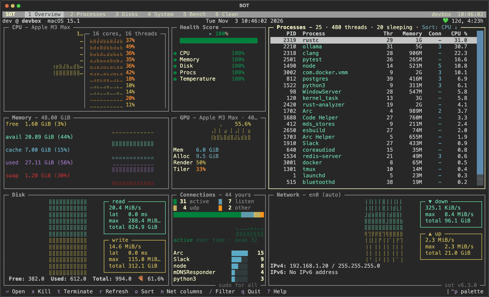
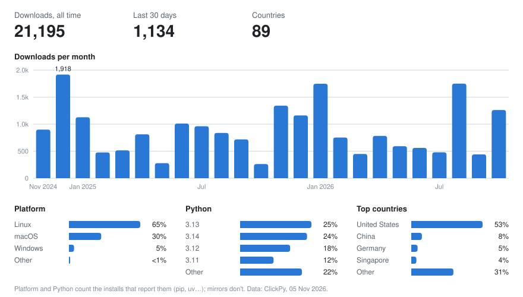

<!--pytest-codeblocks:skipfile-->
<p align="center" style="background-color: #ffffff;">
  <a href="https://github.com/anistark/sot"></a>
  <p align="center">Command-line system observation tool.</p>
</p>


> `sot` is a system monitor for the terminal in the spirit of [top](<https://en.wikipedia.org/wiki/Top_(software)>)

CPU, memory, GPU, disks, network and processes in one live dashboard, plus tools to inspect your machine, benchmark disks and free up space. Works on macOS, Linux and Windows.

[](https://pypi.org/project/sot/) [](https://clickpy.clickhouse.com/dashboard/sot)  [](https://github.com/anistark/sot) [](https://github.com/anistark/sot/graphs/contributors)  [](https://opensource.org/licenses/MIT)



## Install

macOS and Linux, one line (installs Python 3.10+ and pipx if missing):

```sh
curl -fsSL https://raw.githubusercontent.com/anistark/sot/main/install.sh | bash
```

Or with your package manager of choice:

```sh
uv tool install sot                 # uv
pipx install sot                    # pipx
brew install anistark/tools/sot     # Homebrew
```

Windows: use `uv` or `pipx`; the install script doesn't run there.

To move to a newer release, `sot update` takes minor and patch releases and `sot upgrade` takes major ones too. Both work out how sot was installed and go through that tool; add `--dry-run` to see what would run. On Windows they print the command instead, since a running program can't replace itself.

<details>
<summary>DEB / RPM packages (experimental), source installs and release verification</summary>

Download the package from the [releases page](https://github.com/anistark/sot/releases/latest):

```sh
sudo dpkg -i sot-*.deb && sudo apt-get install -f    # Debian, Ubuntu
sudo rpm -ivh sot-*.rpm                              # RHEL, CentOS, Fedora
```

From source:

```sh
git clone https://github.com/anistark/sot.git && cd sot
uv pip install --system .    # or: pipx install .
```

PyPI releases are published from GitHub Actions with [Trusted Publishing](https://docs.pypi.org/trusted-publishers/) and carry [PEP 740 attestations](https://docs.pypi.org/attestations/). To verify a release file:

```sh
uvx pypi-attestations verify pypi --repository https://github.com/anistark/sot pypi:sot-<version>-py3-none-any.whl
```

</details>

## Commands

| Command | What it does |
| --- | --- |
| `sot` | Live dashboard: CPU, memory, GPU, disk, network, connections and processes |
| `sot ps` | Processes, listening ports and running dev environments |
| `sot disk` | Every physical disk with its partitions, usage and I/O |
| `sot disk --list` | The same as a static table, then exits (pipe-friendly) |
| `sot info` | System summary with an OS logo, like neofetch |
| `sot bench` | Disk benchmark: sequential throughput, random IOPS and latency |
| `sot clean` | Find and remove caches, logs, temp files and build output |
| `sot update` | Move to the newest minor or patch release of your major version |
| `sot upgrade` | Move to the newest release, major versions included |
| `sot --keys` | List every key binding and its id |
| `sot --config-path` | Show where the config file lives, with a commented template |

Everything that opens a screen opens the same app on a different view, so you can hop between them with the number keys.

## The app

| Key | View | Shows |
| --- | --- | --- |
| `1` | Overview | CPU per core, health score, top processes, memory, GPU, disk, network and socket graphs |
| `2` | Processes | Process table, listening ports and dev environments (Node, Python, Docker, Ruby, Go, Rust) |
| `3` | Disks | Physical disks and partitions, usage bars, read/write stats |
| `4` | System | What `sot info` prints, with uptime, memory and battery kept live |
| `5` | Bench | Pick a disk and watch each benchmark finish |
| `6` | Clean | Scan, tick what to remove, dry run or clean |

You can also click the tabs in the header. Each view keeps its selection, sort and scroll while you're elsewhere.

**Highlights**

- **Drill down**: `Enter` on an overview panel opens that process, disk or the ports list in its own view; `Esc` comes back
- **Detail drawer**: `Enter` or double-click in a list opens live details that follow the cursor
- **Filter**: `/` filters the focused list by name, PID, user or command
- **Command palette**: `Ctrl+P` jumps to a view, process or volume, kills, terminates or copies a PID, and switches theme
- **Sort anywhere**: click a column header, or press `o`
- **Zoom the overview**: `+` for taller graphs, `-` for more process rows (remembered)
- **GPU stats** on Apple Silicon (`ioreg`, no sudo), NVIDIA (`nvidia-smi`) and AMD (`rocm-smi`, best effort)
- **Connections without root**: on macOS without `sudo` the panel shows your own processes' sockets

### Keys

`?` shows the keys for the focused panel. Every binding can be remapped in the [config](#configuration).

| Key | Action |
| --- | --- |
| `1`-`6` | Switch view |
| `Tab` / `Shift+Tab` | Next / previous panel |
| `↑` `↓` or `k` `j` | Move |
| `PgUp` `PgDn` (`Ctrl+U` `Ctrl+D`), `Home` `End` (`g` `G`) | Page, first, last |
| `Enter` | Open details, or drill down from the overview |
| `Esc` | Close, clear the filter, or go back |
| `/` | Filter |
| `o` | Sort: in process tables pick a column with `←` `→` and flip with `Enter`; in port and dev lists `o` cycles the column and `s` flips |
| `x` / `t` | Kill / terminate the selected process (asks first) |
| `n` | Show or hide the I/O and connection columns |
| `+` / `-` | Overview zoom |
| `r` | Refresh |
| `Ctrl+P` | Command palette |
| `q` | Quit |

## `sot info`

Prints host, model, serial, OS, kernel, firmware, desktop and window manager, shell, terminal, chip (with performance/efficiency cores), GPU, memory, displays, uptime and battery, next to an ASCII logo for macOS, Windows, Ubuntu, Debian, Fedora, RHEL, Arch, Manjaro, Pop!_OS, CentOS or a generic Tux.

```
                  ,MMMM.            Host        -  john@macbook.local
                .MMMMMM             Model       -  MacBook Pro
                MMMMM,              Identifier  -  MacBookPro18,1
      .;MMMMM:' MMMMMMMMMM;.
    MMMMMMMMMMMMNWMMMMMMMMMMM:      OS          -  macOS 14.5.0 Sonoma
  .MMMMMMMMMMMMMMMMMMMMMMMMWM.      Kernel      -  23.5.0
  MMMMMMMMMMMMMMMMMMMMMMMMM.        Shell       -  zsh
 ;MMMMMMMMMMMMMMMMMMMMMMMM:         Terminal    -  iTerm.app (3.5.2)
 :MMMMMMMMMMMMMMMMMMMMMMMM:
 .MMMMMMMMMMMMMMMMMMMMMMMMM.        Chip        -  Apple M1 Pro (8P + 2E cores)
  MMMMMMMMMMMMMMMMMMMMMMMMMMM.      GPU         -  Apple M1 Pro (16 cores)
   .MMMMMMMMMMMMMMMMMMMMMMMMMM.     Memory      -  8 GiB / 32 GiB
     MMMMMMMMMMMMMMMMMMMMMMMM
      ;MMMMMMMMMMMMMMMMMMMM.        Uptime      -  12d 4h 23m
        .MMMM,.    .MMMM,.          Battery     -  87% & Discharging
```

## `sot bench`

Runs four tests on the disk you pick: sequential read, sequential write, random read IOPS and random write IOPS, each with min/avg/max and p50/p95/p99 latency.

```sh
sot bench                                    # pick a disk in the Bench view
sot bench --disk disk3 --duration 5          # no prompt, 5 s per test (default 10)
sot bench --disk / --output results.json     # save results as JSON
```

In the Bench view: `Enter` runs, `+` / `-` change the duration, `e` exports JSON, `Esc` cancels after the current test.

## `sot clean`

Finds caches, logs, temp files and leftovers on your machine, shows how much each one takes, and removes only what you tick.

```sh
sot clean                      # Clean view: tick rows, then clean
sot clean --dry-run            # print what would go, delete nothing
sot clean --force              # also remove data still in use (see below)
sot clean --privacy            # also clear browser cookies, history and site data
sot clean --projects ~/code    # also clear node_modules, target, .venv… in idle projects
sudo sot clean                 # include system logs and temp files that need root
```

In the Clean view: `space` ticks a row, `a` ticks all, `d` dry runs, `c` cleans (asks first), `f` toggles force, `p` toggles privacy, `r` rescans.

**What it finds**

- **Browsers**: caches of Chrome, Chromium, Edge, Brave, Vivaldi, Opera, Arc, Firefox, LibreWolf, Zen and Safari, free space in their databases, and old session snapshots
- **Apps**: Electron app caches (Slack, Discord, VS Code, Cursor, Claude, Obsidian…)
- **Dev tools**: Homebrew, pip, npm, pnpm, Yarn, Bun, uv, Go, Cargo, Gradle, Android and Composer caches; Xcode DerivedData, simulator caches and old device support
- **Coding agents**: Claude Code, Codex, pi, opencode and Kilo Code caches, and old Claude Code and Cursor binaries
- **System**: app and system logs, old temp files, Trash, crash dumps, thumbnails, the macOS installer leftovers, the systemd journal and old snaps on Linux, downloaded updates and Prefetch on Windows
- **Review only**: models (Ollama, LM Studio, Hugging Face), VM disks (Docker, OrbStack, Colima), simulators, toolchains and backups are measured and shown, never deleted

**Safety**

- Asks before deleting, in the view and in the printed flow
- Conversation history, sessions, credentials and config are never touched
- Temp folders and logs only lose files older than a few days; folders and sockets stay
- Fonts, Spotlight, iCloud state, virtualenvs and downloaded browsers inside cache folders are kept
- Symlinks are removed, never followed
- Root-only targets are skipped unless you run with `sudo`
- `--force` is needed for in-use data: the newest browser session (the one that restores your tabs), browser copies still open, the newest device support files and projects touched in the last 14 days

<details>
<summary>Details: browser sessions, privacy, projects, agent caches and relocated directories</summary>

**Browser sessions.** Browsers keep many saved copies of your open tabs and only read the newest. `sot clean` removes the old ones. `--force` removes the newest too, so the browser starts with no tabs to restore. Quit the browser first, or it writes the session straight back.

| Browser | Old snapshots | Also with `--force` |
| --- | --- | --- |
| Chrome, Chromium, Edge, Brave, Vivaldi, Opera, Arc | All but the newest `Session_*`, `Tabs_*` and `Apps_*` in each profile's `Sessions` folder | The newest of each |
| Firefox, LibreWolf, Zen | `sessionstore-backups/upgrade.jsonlz4-*` | `sessionstore.jsonlz4` and the `recovery` and `previous` files |

**Privacy.** `--privacy` adds per-browser rows for cookies, history and site data (IndexedDB, local storage, service workers), plus recent items and macOS window state over 30 days old. Clearing cookies signs you out of every site. Firefox keeps history and bookmarks in one database, so its history is left alone.

**Projects.** `--projects DIR` looks for `node_modules`, `.next`, `target`, `.venv`, `__pycache__`, `Pods`, `.build`, Gradle `build` and more. A folder only counts when the file that rebuilds it sits beside it (`target` next to `Cargo.toml`, `node_modules` next to `package.json`).

**Coding agents.** Only installed agents are listed, and only caches, logs and scratch folders are touched.

| Agent | Cleaned |
| --- | --- |
| Claude Code | `~/.claude/{cache,paste-cache,debug,shell-snapshots,session-env,statsig}`, `~/.cache/claude`, `~/Library/Caches/claude-cli-nodejs`, and binaries in `~/.local/share/claude/versions` other than the newest, the linked one and any running |
| Codex | `~/.codex/{.tmp,log}`, `~/.cache/codex-runtimes` |
| pi | `~/.pi/{cache,logs}`, `~/.cache/pi` |
| opencode | `~/.cache/opencode`, `~/.local/share/opencode/{cache,log}` |
| Kilo Code | `~/.kilocode/cache`, and `kilocode.kilo-code/{cache,checkpoints}` in VS Code, Cursor and VSCodium storage |

Left alone: `~/.claude/projects` (what `claude --resume` reads) and `~/.gemini/tmp`.

**Relocated directories.** Paths follow these variables from the shell you run `sot` in: `CLAUDE_CONFIG_DIR`, `XDG_CACHE_HOME`, `XDG_DATA_HOME`, `XDG_CONFIG_HOME`, `APPDATA`, `LOCALAPPDATA`, `VSCODE_PORTABLE`, `CARGO_HOME`, `RUSTUP_HOME`, `GOPATH`, `GOMODCACHE`, `GOCACHE`, `GRADLE_USER_HOME`, `NVM_DIR`, `UV_CACHE_DIR`, `BUN_INSTALL_CACHE_DIR`, `HF_HOME` and `OLLAMA_MODELS`. Run `sot clean --dry-run` to see the resolved paths.

</details>

## Options

| Flag | What it does |
| --- | --- |
| `--theme`, `-T` | Colour theme: `classic` (follows your terminal) or `cyberpunk` (neon) |
| `--net`, `-N` | Network interface for the overview, e.g. `sot -N en0` (default: auto-detect) |
| `--disk`, `-D` | Volume for the overview, e.g. `sot -D /Volumes/External`; with no value, pick one in sot |
| `--log`, `-L` | Write a debug log to this file |
| `--version`, `-V` | Show the version |
| `--help`, `-H` | Show help (`sot <command> -h` for a command's flags) |

Switch theme while running with `Ctrl+P` → Theme; graphs and selections are kept and the choice is remembered. `SOT_THEME=cyberpunk` sets the default.

## Configuration

Optional, at `~/.config/sot/config.toml` (follows `$XDG_CONFIG_HOME`; `sot --config-path` prints it):

```toml
theme = "cyberpunk"          # classic, cyberpunk
default_view = "processes"   # overview, processes, disks, system, bench, clean
net = "en0"                  # network interface on the overview
disk = "/"                   # mountpoint on the overview

[refresh]                    # seconds
cpu = 1.0
processes = 2.0

[keymap]                     # binding id = keys, see `sot --keys`
"sot.process.kill" = "ctrl+k"
"sot.view.processes" = "p"
```

Every key is optional and invalid values are reported and ignored. Flags win over `SOT_THEME`, which wins over the config file.

## Downloads

<a href="https://clickpy.clickhouse.com/dashboard/sot">
  <picture>
    <source media="(prefers-color-scheme: dark)" srcset="https://raw.githubusercontent.com/anistark/sot/refs/heads/main/images/pypi-stats-dark.svg">
    
  </picture>
</a>

Refreshed monthly from ClickHouse's public PyPI dataset; more on [ClickPy](https://clickpy.clickhouse.com/dashboard/sot).

---

Built with [Textual](https://github.com/textualize/textual), [Rich](https://github.com/textualize/rich) and [psutil](https://github.com/giampaolo/psutil). Tested on macOS and Ubuntu; if it works (or doesn't) on your system, [open an issue](https://github.com/anistark/sot/issues). See the [changelog](https://github.com/anistark/sot/blob/main/CHANGELOG.md) for what's new and [CONTRIBUTING.md](https://github.com/anistark/sot/blob/main/CONTRIBUTING.md) to help out.

Started on top of [tiptop](https://github.com/nschloe/tiptop) when it became unmaintained. Other tops worth a look: [btop](https://github.com/aristocratos/btop), [bottom](https://github.com/ClementTsang/bottom), [Glances](https://github.com/nicolargo/glances), [gtop](https://github.com/aksakalli/gtop), [htop](https://github.com/htop-dev/htop).

<p align="center">🏴 ≈ 🏴</p>
